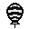

# Silly Embed Test

Testing GitHub Markdown image embeds using the first frame from each classic low-tier Bloon sprite.

> These use direct `raw.githubusercontent.com` URLs. The PNGs stay in this repository; this file only embeds them.

## Red Bloon


Source: [sprites/Red_Bloon_Spr/8ce2eb56-2e2e-4b31-b137-f2f2b9d25060.png](sprites/Red_Bloon_Spr/8ce2eb56-2e2e-4b31-b137-f2f2b9d25060.png) · 12 animation frames in the sprite metadata.

## Blue Bloon


Source: [sprites/Blue_Bloon_Spr/0c9f13ec-5002-4bfb-bd58-9969a58dabd6.png](sprites/Blue_Bloon_Spr/0c9f13ec-5002-4bfb-bd58-9969a58dabd6.png) · 11 animation frames in the sprite metadata.

## Green Bloon


Source: [sprites/Green_Bloon_Spr/db52aef9-7b07-4161-964b-6536b2cd8ca5.png](sprites/Green_Bloon_Spr/db52aef9-7b07-4161-964b-6536b2cd8ca5.png) · 11 animation frames in the sprite metadata.

## Yellow Bloon


Source: [sprites/Yellow_Bloon_Spr/8fc489a3-14a9-4411-9854-81707cfcffc0.png](sprites/Yellow_Bloon_Spr/8fc489a3-14a9-4411-9854-81707cfcffc0.png) · 11 animation frames in the sprite metadata.

## Pink Bloon


Source: [sprites/Pink_Bloon_Spr/ecc4b74c-aedc-42b8-8e7c-097fc99547bd.png](sprites/Pink_Bloon_Spr/ecc4b74c-aedc-42b8-8e7c-097fc99547bd.png) · 11 animation frames in the sprite metadata.

## Black Bloon


Source: [sprites/Black_Bloon_Spr/cf09eade-621f-49b5-b234-63f9d04aa4f2.png](sprites/Black_Bloon_Spr/cf09eade-621f-49b5-b234-63f9d04aa4f2.png) · 11 animation frames in the sprite metadata.

## White Bloon


Source: [sprites/White_Bloon_Spr/31e227ff-fc90-4512-a39d-6e470af29a40.png](sprites/White_Bloon_Spr/31e227ff-fc90-4512-a39d-6e470af29a40.png) · 11 animation frames in the sprite metadata.

## Zebra Bloon



Source: [sprites/Zebra_Bloon_Spr/9436bfd0-ace9-47d8-905a-dbcd7b9e4a22.png](sprites/Zebra_Bloon_Spr/9436bfd0-ace9-47d8-905a-dbcd7b9e4a22.png) · 11 animation frames in the sprite metadata.

## Rainbow Bloon


Source: [sprites/Rainbow_Bloon_Spr/eec91077-bd4e-4db1-8836-ae3e34ed732b.png](sprites/Rainbow_Bloon_Spr/eec91077-bd4e-4db1-8836-ae3e34ed732b.png) · 11 animation frames in the sprite metadata.

## Ceramic Bloon


Source: [sprites/Ceramic_Bloon_Spr/910d2b0a-c7bf-4c3f-8a54-f6f96fa7e321.png](sprites/Ceramic_Bloon_Spr/910d2b0a-c7bf-4c3f-8a54-f6f96fa7e321.png) · 15 animation frames in the sprite metadata.

## External-repository CDN test

External-repository embeds work the same way: use a public repository's raw file URL, or jsDelivr's GitHub CDN URL.

```md

```

Replace `OWNER`, `REPO`, `BRANCH`, and the path with a real public image. This is a syntax example, not a live asset embed.