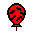
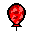
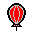
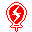
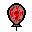
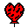
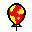
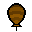

# Silly Embed Test

Testing GitHub Markdown image embeds using Bloon sprite frames. Red Bloon includes every frame; the other classic low-tier Bloons currently show their first frame.

> These use direct `raw.githubusercontent.com` URLs. The PNGs stay in this repository; this file only embeds them.

## Red Bloon

All 12 frames in the Red Bloon sprite, in the order listed by `Red_Bloon_Spr.yy`.

### Frame 01


Normal
[Source PNG](sprites/Red_Bloon_Spr/8ce2eb56-2e2e-4b31-b137-f2f2b9d25060.png)

### Frame 02


Tattered
[Source PNG](sprites/Red_Bloon_Spr/0e6a90c7-6ac7-45ea-9ea6-3f153889c3f1.png)

### Frame 03


Shield
[Source PNG](sprites/Red_Bloon_Spr/c45840a4-0302-46f2-ba3a-b486a2a79a29.png)

### Frame 04


Regrow
[Source PNG](sprites/Red_Bloon_Spr/5034dbda-dc9f-41a4-8acc-c2db1ced18e1.png)

### Frame 05


Camo
[Source PNG](sprites/Red_Bloon_Spr/ac652848-e667-4c91-997b-a73f7e82eb38.png)

### Frame 06


Lead
[Source PNG](sprites/Red_Bloon_Spr/5865d90f-c02e-490f-a3bb-e1d9f8550bce.png)

### Frame 07


Energized
[Source PNG](sprites/Red_Bloon_Spr/9eb1378e-c835-47d6-8bb4-4d35e2f60d1f.png)

### Frame 08


Camo Lead
[Source PNG](sprites/Red_Bloon_Spr/cd516d20-a4bd-436e-9fc3-8fc4b40a4ce6.png)

### Frame 09


Regrow Tattered
[Source PNG](sprites/Red_Bloon_Spr/b4dd112e-1f70-497b-8395-abdf0647f1f3.png)

### Frame 10


??
[Source PNG](sprites/Red_Bloon_Spr/1952b27d-4819-43aa-9017-d36cc8602530.png)

### Frame 11


Glued
[Source PNG](sprites/Red_Bloon_Spr/fd1a856a-7d5e-4ed9-9b23-683d21f05dd6.png)

### Frame 12


Looks like Normal idk
[Source PNG](sprites/Red_Bloon_Spr/0e6f808d-1af1-479e-b9fa-e8ea72bdabef.png)

## Blue Bloon


Source: [sprites/Blue_Bloon_Spr/0c9f13ec-5002-4bfb-bd58-9969a58dabd6.png](sprites/Blue_Bloon_Spr/0c9f13ec-5002-4bfb-bd58-9969a58dabd6.png) · 11 animation frames in the sprite metadata.

## Green Bloon


Source: [sprites/Green_Bloon_Spr/db52aef9-7b07-4161-964b-6536b2cd8ca5.png](sprites/Green_Bloon_Spr/db52aef9-7b07-4161-964b-6536b2cd8ca5.png) · 11 animation frames in the sprite metadata.

## Yellow Bloon


Source: [sprites/Yellow_Bloon_Spr/8fc489a3-14a9-4411-9854-81707cfcffc0.png](sprites/Yellow_Bloon_Spr/8fc489a3-14a9-4411-9854-81707cfcffc0.png) · 11 animation frames in the sprite metadata.

## Pink Bloon


Source: [sprites/Pink_Bloon_Spr/ecc4b74c-aedc-42b8-8e7c-097fc99547bd.png](sprites/Pink_Bloon_Spr/ecc4b74c-aedc-42b8-8e7c-097fc99547bd.png) · 11 animation frames in the sprite metadata.

## Black Bloon


Source: [sprites/Black_Bloon_Spr/cf09eade-621f-49b5-b234-63f9d04aa4f2.png](sprites/Black_Bloon_Spr/cf09eade-621f-49b5-b234-63f9d04aa4f2.png) · 11 animation frames in the sprite metadata.

## White Bloon


Source: [sprites/White_Bloon_Spr/31e227ff-fc90-4512-a39d-6e470af29a40.png](sprites/White_Bloon_Spr/31e227ff-fc90-4512-a39d-6e470af29a40.png) · 11 animation frames in the sprite metadata.

## Zebra Bloon


Source: [sprites/Zebra_Bloon_Spr/9436bfd0-ace9-47d8-905a-dbcd7b9e4a22.png](sprites/Zebra_Bloon_Spr/9436bfd0-ace9-47d8-905a-dbcd7b9e4a22.png) · 11 animation frames in the sprite metadata.

## Rainbow Bloon


Source: [sprites/Rainbow_Bloon_Spr/eec91077-bd4e-4db1-8836-ae3e34ed732b.png](sprites/Rainbow_Bloon_Spr/eec91077-bd4e-4db1-8836-ae3e34ed732b.png) · 11 animation frames in the sprite metadata.

## Ceramic Bloon



Source: [sprites/Ceramic_Bloon_Spr/910d2b0a-c7bf-4c3f-8a54-f6f96fa7e321.png](sprites/Ceramic_Bloon_Spr/910d2b0a-c7bf-4c3f-8a54-f6f96fa7e321.png) · 15 animation frames in the sprite metadata.

## External-repository CDN test

External-repository embeds work the same way: use a public repository's raw file URL, or jsDelivr's GitHub CDN URL.

```md

```

Replace `OWNER`, `REPO`, `BRANCH`, and the path with a real public image. This is a syntax example, not a live asset embed.
